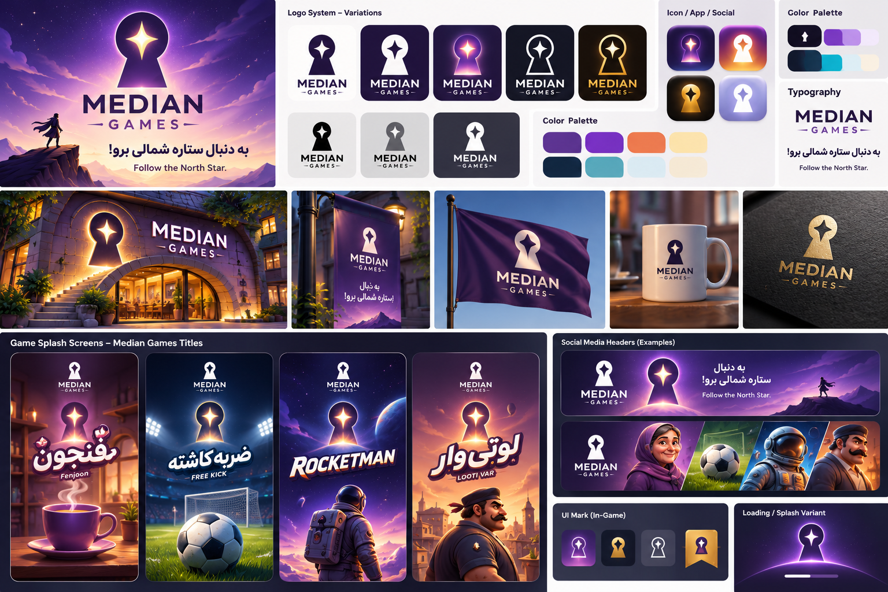

# هویت بصری مدین گیمز | ستارهٔ شمالی

تصویر مرجع ارائه‌شده توسط امیر در ۸ نوامبر ۲۰۲۶.

- **نام برند:** مدین گیمز / MEDIAN GAMES
- **نشان:** فرم سوراخ کلید با ستارهٔ چهارپر در مرکز.
- **شعار فارسی:** «به دنبال ستاره شمالی برو!»
- **شعار انگلیسی:** “Follow the North Star.”
- **رنگ‌ها:** بنفش تیره و یاسی، نارنجی و طلایی گرم، سرمه‌ای، آبی‌ـ‌فیروزه‌ای و کرم. نمونه‌های رنگ در تصویر دیده می‌شوند.
- **گونه‌های لوگو:** روشن و تیره، تک‌رنگ، خطی، طلایی و درخشان، همراه با نمونه‌های آیکون اپ و شبکه‌های اجتماعی.
- **نمونه‌های کاربرد:** سربرگ شبکه‌های اجتماعی، اسپلش بازی‌ها، نشان داخل بازی و صفحهٔ بارگذاری، تابلو، پرچم و اقلام چاپی.

**وضعیت ثبت:** تصویر اصلی به‌عنوان مرجع بصری در مستندات پروژه نگهداری می‌شود. نشان فعلی وب‌سایت طبق تصمیم قبلی، «درگاه مدین / Folded Worlds» است. جایگزینی نشان فعلی تصمیم جداگانه‌ای است. فایل همراه، تصویر مرجع PNG است.

